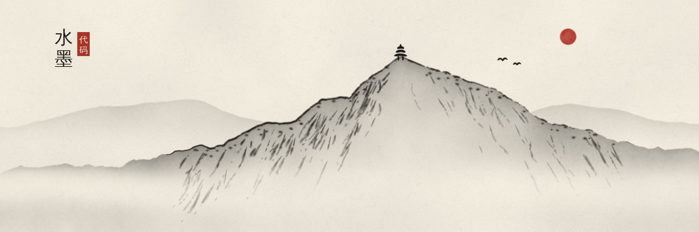
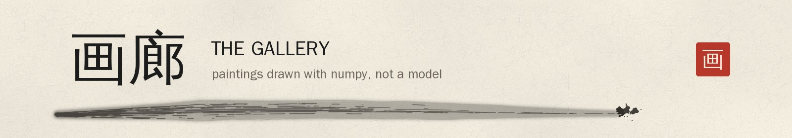
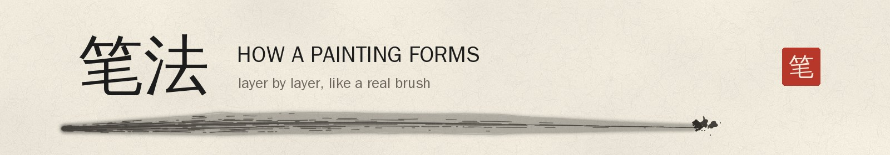
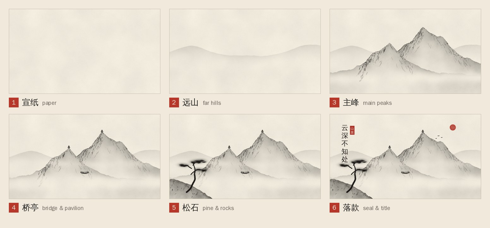
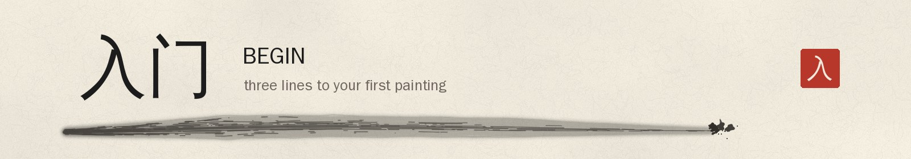
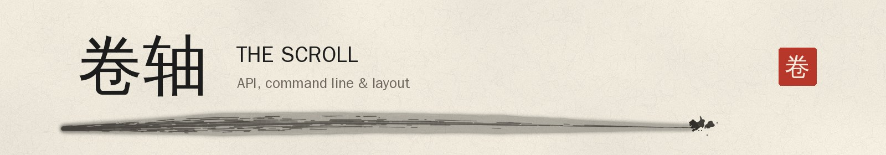

<div align="center">



<br/><br/>

<h1>水 墨 &nbsp;·&nbsp; <i>chinese ink wash</i></h1>

<p><i>Ink, water, paper, all made of numbers.</i><br/>
<sub>Chinese ink wash paintings drawn entirely in code, without an image model. Every wash, brush stroke and mist band is computed with numpy + Pillow.</sub></p>

<p>


</p>

<sub><a href="#画廊">画廊 Gallery</a> &nbsp;·&nbsp; <a href="#笔法">笔法 Process</a> &nbsp;·&nbsp; <a href="#入门">入门 Begin</a> &nbsp;·&nbsp; <a href="#卷轴">卷轴 Reference</a></sub>

</div>

<br/>

<a name="画廊"></a>


<div align="center">


<sub><b>云深不知处</b> &nbsp;<i>Lost somewhere in the deep clouds</i>: misty peaks, pine, bridge and pavilion</sub>

<br/><br/>


<sub><b>水</b> &nbsp;<i>Water</i>: calligraphy, a dry-brush wave and a swordsman, written stroke by stroke</sub>

</div>

<br/>

<a name="笔法"></a>


<div align="center">

<br/>
<sub>Paper first, then distant hills, peaks, bridge and pavilion, pines and rocks, and finally the title and red seal.<br/>Strokes swell and thin with pressure, run dry into <b>飞白</b> (flying white), and bleed wet ink into the paper.</sub>
</div>

<br/>

<a name="入门"></a>


```bash
git clone --recurse-submodules https://github.com/raj-in-jp/chinese-ink-wash.git
cd chinese-ink-wash && pip install -r requirements.txt
python -m poly_ink cloud-temple out.png --gif out.gif
```

```python
from poly_ink import ink_landscape
ink_landscape("江山如画", seal="墨韵", seed=9).save("my_painting.png")   # your own landscape
```

<br/>

<a name="卷轴"></a>


<details>
<summary><b>📜 Setup & fonts</b></summary>

```bash
git clone --recurse-submodules https://github.com/raj-in-jp/chinese-ink-wash.git
cd chinese-ink-wash
pip install -r requirements.txt
# already cloned without the submodule?  git submodule update --init
```

Titles and seals need a Chinese font. `chinese ink wash` finds Kaiti/Songti on macOS, KaiTi/SimSun on Windows, and
WenQuanYi or Noto CJK on Linux (`sudo apt install fonts-wqy-zenhei`). To use another font, set
`INKPAINT_FONT=/path/to/font.ttf`. Without a font the painting still renders, just without the title and seal.

</details>

<details>
<summary><b>🖌️ Use it from Python</b></summary>

Run from the repo root, or put the repo root on `PYTHONPATH` / `sys.path`.

```python
from poly_ink import cloud_temple, ink_landscape, make_gif

# the finished painting 云深不知处 (1920x1080 PIL Image)
cloud_temple().save("cloud_temple.png")

# your own landscape: title, seal, seed (changes the brushwork) and size are all configurable
img = ink_landscape("江山如画", seal="墨韵", seed=9, width=1280, height=720)
img.save("landscape.jpg", quality=92)

# draw-on animation: get the stage snapshots, then write a looping GIF
img, stages = ink_landscape("山水", with_stages=True)   # stages = [(name, Image), ...]
make_gif(stages, "landscape.gif")
```

Each call returns a Pillow `Image`, so you can also resize it, paste it into another image, or return it from a
web handler. A 1920x1080 painting takes about 4 seconds. In a web app, render it once and cache the result.

</details>

<details>
<summary><b>✒️ Brush writing: calligraphy and big expressive strokes</b></summary>

`poly_ink.brush` is a fast bristle brush. Strokes swell and thin with pressure, run dry into flying white
(飞白), bleed wet ink into the paper and flick off splatter. Each stroke records when the brush reached every
pixel, so an animation shows it being written in stroke order instead of fading in.

```python
from poly_ink import water_swordsman, animate_scene
s = water_swordsman()                 # 水 + a dry-brush wave + a swordsman in a straw hat
s.render().save("water.png")          # the finished painting
s.render(at=2500).save("mid.png")     # how it looks 2.5 s into the painting
animate_scene(s, "water.gif")         # the whole thing written stroke by stroke (≈10.8 s GIF)
```

Write your own with `InkScene`, adding strokes with a start time and a duration in milliseconds:

```python
from poly_ink import InkScene, brush_stroke, sweep, splatter, animate_scene
from poly_ink.brush import PRESS_DOWN, HOOK

W, H = 1280, 720
s = InkScene(W, H, seed=1)
t = s.add(brush_stroke(W, H, [(300, 120), (296, 400), (250, 380)], 48, dry=0.45, profile=HOOK), 0, 500)
t = s.add(brush_stroke(W, H, [(420, 150), (360, 300)], 36, dry=0.4, profile=PRESS_DOWN), t + 150, 300)
t = s.add(sweep(W, H, [(500, 650), (800, 400), (1250, 300)], 110, dry=0.6), t + 200, 400)   # dry-brush sweep
s.add(splatter(W, H, 1150, 300, (120, 60), n=40), t - 100, 200)                            # flung ink
s.seal("墨", 1180, 600, 36, start=t + 300)
animate_scene(s, "mine.gif")
```

| Call | What it paints |
|---|---|
| `brush_stroke(W, H, pts, width, ink, dry, profile, bristles, fill, wet, red)` | one brush stroke along smoothed control points. `profile` sets the pressure: `PRESS_DOWN` (lift to a sharp tip), `BLUNT`, `HOOK`, `SWEEP`, `RISE`, or your own `((t, width), ...)` |
| `sweep(W, H, pts, width, ink, dry, wash, profile)` | a big dry-brush sweep: a pale wet body under broken dark bristle streaks |
| `splatter(W, H, x, y, (sx, sy), n, size, direction)` | flicked ink drops |
| `wash(W, H, polygon, ink)` | a flat ink wash (hats, robes, rocks), revealed top to bottom |
| `s.p` | the underlying claude-drawing `Painting`, for paper, misty mountains (`ridge` + `wash`, then `s.add_background()`) |

</details>

<details>
<summary><b>⌨️ Command line</b></summary>

```bash
python -m poly_ink cloud-temple out.png --gif out.gif
python -m poly_ink water-swordsman out.png --gif out.gif
python -m poly_ink landscape out.jpg --title 江山如画 --seal 墨韵 --seed 9 --size 1280x720 --stages stages/ --gif out.gif
python -m poly_ink --help
```

</details>

<details>
<summary><b>🗺️ Layout</b></summary>

| Path | What |
|---|---|
| `poly_ink/scenes.py` | `cloud_temple()` and `ink_landscape()` — the scenes, written with the skill's `Painting` API |
| `poly_ink/brush.py` | the bristle brush, splatter, washes and `InkScene` (strokes with timing) |
| `poly_ink/calligraphy.py` | `water_swordsman()` — 水, the wave and the swordsman |
| `poly_ink/animate.py` | `make_gif()` — stages → GIF (720x405, 900 ms per stage, 5-frame crossfades, 2.6 s final hold); `animate_scene()` — an `InkScene` written stroke by stroke |
| `poly_ink/__main__.py` | command line |
| `drawing_output/` | the rendered 云深不知处: PNG/JPG, stage snapshots, GIF, and the original scripts |
| `tests/` | `python -m pytest tests` |

To draw something new, copy `cloud_temple()` in `poly_ink/scenes.py` and change it. The available drawing calls
(`peak`, `wash`, `cun`, `pine`, `rock`, `pagoda`, `traveller`, `birds`, `sun`, `mist`, `trails`, `stroke`, …) are
listed in the "水墨 `Painting`" section of `.claude/skills/claude-drawing/SKILL.md`.

</details>

<br/>

<div align="center">

<br/>
<sub>Painted with the <a href="https://github.com/cloveric/claude-drawing-skill">claude-drawing</a> skill · the same seed always gives the same picture</sub>
</div>
